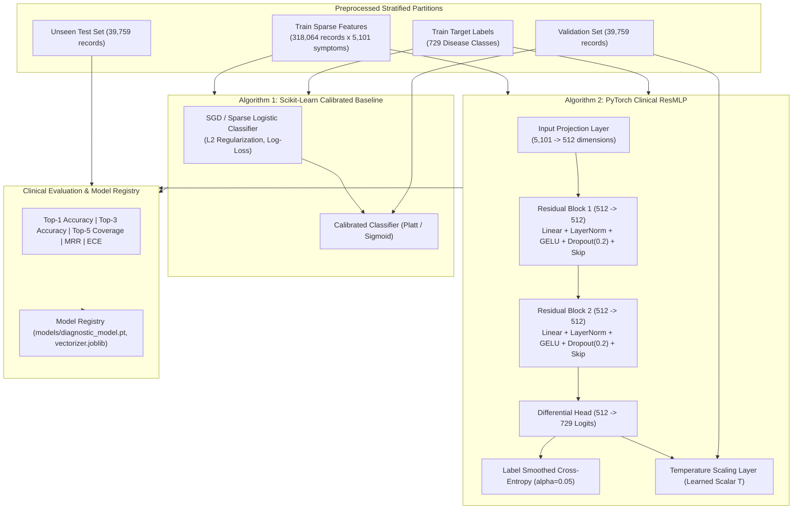

# Senior Machine Learning Engineer Blueprint: Clinical Model Training & Differential Architecture

> **Domain:** Production-Grade Clinical Patient Symptom Checker  
> **Engineering Level:** 10+ Years Senior AI/ML Engineer Standard  
> **Target Subsystems:** PyTorch Deep Residual MLP, Scikit-Learn Sparse Calibrated Benchmark, Temperature Calibration, Top-K Loss  
> **Target Specification:** [`model_building/model_condition.md`](file:///Users/jayesh/Documents/RLHF_patient_model/model_building/model_condition.md)  
> **Status:** Stage 04 & 05 Execution Blueprint

---

## 1. Problem Formulation & Multi-Algorithm Strategy

In diagnostic clinical decision support, relying on a single algorithm is an anti-pattern. We deploy a **Dual-Architecture Strategy**:
1. **Scikit-Learn Calibrated Sparse Benchmark (Algorithm 1):**
   - High-speed, convex baseline using L2-regularized multi-class Logistic Regression with sparse feature matrices.
   - Evaluates linear separability across all 729 conditions and serves as our ultra-low latency fallback ($< 1\text{ ms}$).
2. **PyTorch Clinical Residual Multilayer Perceptron (ResMLP) (Algorithm 2):**
   - Deep non-linear architecture that captures multi-symptom syndromic interactions and higher-order correlations.
   - Enhanced with **Residual Skip Connections**, **Label Smoothing ($\alpha = 0.05$)**, and **Post-Hoc Temperature Calibration**.

---

## 2. Mathematical Layer Breakdown (PyTorch Clinical ResMLP)

### Layer 1: Input Projection Layer
$$\mathbf{z}_0 = \text{LayerNorm}\Big(\text{GELU}\big(\mathbf{W}_{\text{in}} \mathbf{x} + \mathbf{b}_{\text{in}}\big)\Big)$$
- $\mathbf{x} \in \{0, 1\}^{5101}$: Multi-hot sparse binary symptom indicator vector.
- $\mathbf{W}_{\text{in}} \in \mathbb{R}^{512 \times 5101}$, $\mathbf{b}_{\text{in}} \in \mathbb{R}^{512}$.
- **Design Rationale:** Compresses high-dimensional ($5,101$) sparse symptom inputs into a dense $512$-dimensional latent clinical representation. Uses `LayerNorm` to stabilize variance across varying symptom lengths ($\mu = 4.02$).

### Layer 2 & 3: Stacked Residual Blocks with Skip Connections
For residual block $k \in \{1, 2\}$:
$$\mathcal{F}_k(\mathbf{z}_{k-1}) = \mathbf{W}_{k,2} \cdot \Big(\text{Dropout}_{0.2}\big(\text{GELU}(\text{LayerNorm}(\mathbf{W}_{k,1} \mathbf{z}_{k-1} + \mathbf{b}_{k,1}))\big)\Big) + \mathbf{b}_{k,2}$$
$$\mathbf{z}_k = \text{GELU}\big(\mathbf{z}_{k-1} + \mathcal{F}_k(\mathbf{z}_{k-1})\big)$$
- **Design Rationale:** As established in our research review, standard deep networks suffer from feature entanglement on clinical tabular data. The identity skip connection ($\mathbf{z}_{k-1} + \mathcal{F}_k(\mathbf{z}_{k-1})$) ensures that subtle, pathognomonic symptoms (e.g., *rusty sputum* or *unilateral facial drooping*) are not washed out by deep non-linear transformations.

### Layer 4: Differential Head & Multi-Class Logits
$$\mathbf{z}_{\text{out}} = \mathbf{W}_{\text{out}} \mathbf{z}_2 + \mathbf{b}_{\text{out}}$$
- $\mathbf{W}_{\text{out}} \in \mathbb{R}^{729 \times 512}$, $\mathbf{b}_{\text{out}} \in \mathbb{R}^{729}$.
- Produces raw unnormalized log-probabilities (logits) over all 729 validated pathologies.

### Layer 5: Objective Function with Label Smoothing ($\alpha = 0.05$)
$$\mathcal{L}_{\text{CE}}(\mathbf{z}_{\text{out}}, y) = - \sum_{c=1}^{729} q_c \log \frac{\exp(z_{\text{out}, c})}{\sum_j \exp(z_{\text{out}, j})}$$
Where the smoothed target distribution $q_c$ is:
$$q_c = \begin{cases} 1 - \alpha + \frac{\alpha}{729}, & \text{if } c = y \\ \frac{\alpha}{729}, & \text{if } c \neq y \end{cases}$$
- **Clinical Rationale:** Our pre-preprocessing audit discovered **17,088 identical symptom sets** that clinically present across multiple conditions (e.g., *Pseudomembranous colitis* vs *C. difficile*). Hard one-hot targets force overconfident gradient updates. Label smoothing relaxes this boundary, directly reflecting differential diagnosis ambiguity.

### Layer 6: Temperature Scaling Probability Calibration (Guo et al., 2017)
$$\hat{P}(D = c \mid \mathbf{x}) = \frac{\exp(z_{\text{out}, c} / T)}{\sum_{j=1}^{729} \exp(z_{\text{out}, j} / T)}$$
- $T > 0$ is a scalar parameter learned on the validation partition ($39,759$ patients) by minimizing negative log-likelihood (NLL).
- **Clinical Rationale:** Deep networks are overconfident. Temperature scaling preserves the exact ranking ($T$ is monotonic) while calibrating probabilities so that a 90% confidence prediction actually corresponds to a 90% empirical clinical outcome.

---

## 3. Comprehensive Evaluation Protocol & Clinical Metrics

We evaluate both algorithms on the **39,759 unseen test patients** using 5 rigorous clinical metrics:

1. **Top-1 Accuracy ($ACC@1$):** Proportion of times the exact primary diagnosis is rank-1.
2. **Top-3 Accuracy ($ACC@3$):** Proportion of times the true diagnosis is within the top-3 differential hypotheses.
3. **Top-5 Coverage ($ACC@5$):** Primary clinical benchmark ensuring the patient's condition is not missed in the differential list.
4. **Mean Reciprocal Rank (MRR):**
   $$\text{MRR} = \frac{1}{N} \sum_{i=1}^N \frac{1}{\text{rank}_i}$$
5. **Expected Calibration Error (ECE):**
   $$\text{ECE} = \sum_{m=1}^{10} \frac{|B_m|}{N} \big| \text{acc}(B_m) - \text{conf}(B_m) \big|$$
   Measures confidence reliability across 10 probability bins. Target: $\text{ECE} < 0.05$.

---

## 4. Implementation & Verification Plan

1. **Step 1: Scikit-Learn Calibrated Baseline Module (`model_building/models/sklearn_baseline.py`)**
   - Implements `SparseClinicalClassifier` with SGD / LogisticRegression.
   - Trains on `train.csv` (318K rows) in sparse CSR format.
   - Computes baseline $ACC@1$, $ACC@3$, $ACC@5$, and MRR on `test.csv`.

2. **Step 2: PyTorch Clinical ResMLP Module (`model_building/models/pytorch_resmlp.py`)**
   - Implements `ClinicalResMLP`, `ResidualBlock`, and `TemperatureScaler`.
   - Custom Dataset & DataLoader streaming sparse CSR tensors efficiently with PyTorch.
   - Mixed-precision training (`torch.cuda.amp` / CPU float32), AdamW optimizer, cosine annealing learning rate scheduler.

3. **Step 3: Clinical Model Evaluator & Comparison (`model_building/models/evaluate_models.py`)**
   - Benchmarks both models side-by-side on test data.
   - Emits a comprehensive `model_evaluation_report.json` with calibration curves and top-k metrics.

4. **Step 4: Strict Unit Tests (`tests/test_model_training.py`)**
   - Verifies model forward passes, gradient updates, shape consistency, and calibration scaling.

5. **Step 5: Reference Notebook Integration (`model_building/process.ipynb`)**
   - Appends executable cells for model training, calibration, and evaluation so they can be run and verified step by step.

