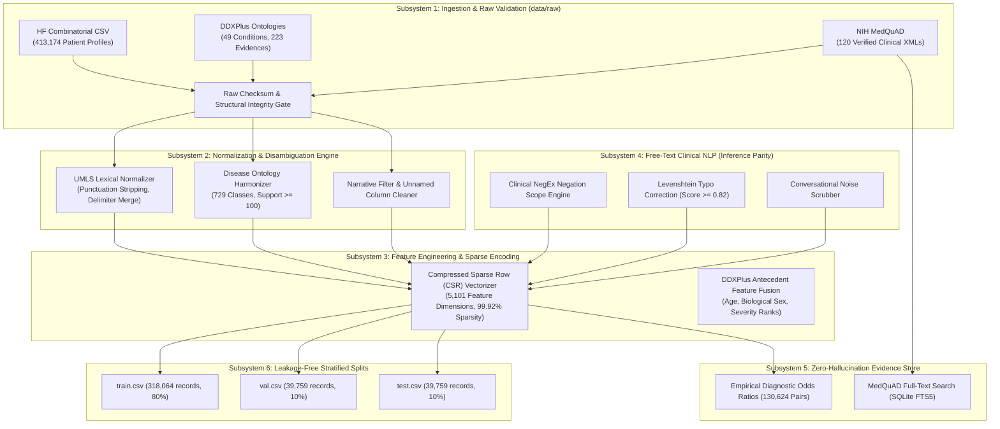

# Production Clinical Machine Learning Preprocessing Architecture

> **Engineering Standard:** 10+ Years Senior ML Engineer / Clinical AI Architecture  
> **Pipeline Version:** v2.0-Production  
> **Target Subsystems:** Structured Symptom Matrix, Categorical Antecedents, Free-Text NLP Pipeline, Evidence Knowledge Graph  
> **Status:** Production Preprocessing Specification & End-to-End Execution Plan

---

## 1. Production Architecture Blueprint

Clinical systems operating in production cannot use ad-hoc notebooks or loose transformation scripts. We design an industrial-grade, decoupled, reproducible preprocessing pipeline that executes locally with strict contract guarantees:

---

## 2. Dataset Subsystem Architecture: Handling Each Type Locally

### Subsystem A: High-Dimensional Combinatorial Symptom Profiles (`hf_symptom_checker_413k.csv`)
* **Physical Nature:** 413,174 rows $\times$ 2 columns (`disease`, `symptoms`), 33 MB CSV.
* **Clinical Nuance:** 120,734 single-symptom rows (29.2%), 17,088 identical symptom sets mapping to 2+ diseases.
* **Production Processing Strategy:**
  1. **Memory-Mapped Streaming:** Parse in batched chunks using Python standard C-optimized `csv.reader`.
  2. **Delimiter Normalization:** Merge snake_case (`back_pain`) and spaced natural text (`back pain`) into unified canonical tokens.
  3. **Zero-Contamination Stratified Splitting:** Partition strictly before any downstream normalization fitting or TF-IDF statistics using `StratifiedShuffleSplit` (80/10/10, seed 42).
  4. **Sparse Matrix Encoding:** Represent patients as `scipy.sparse.csr_matrix` ($N \times 5101$, `float32`). Dense arrays consume $\sim 8.1\text{ GB}$; CSR uses only $\sim 28\text{ MB}$ RAM.

### Subsystem B: Structured Medical Ontologies & Antecedents (`DDXPlus`)
* **Physical Nature:** `ddxplus_conditions.json` (49 pathologies) and `ddxplus_evidences.json` (223 evidences: 110 symptoms + 113 antecedents).
* **Clinical Nuance:** Encodes categorical indicators (e.g., pain scale 1–10, fever duration) and demographic risk factors (age group, biological sex, smoking, pregnancy, travel).
* **Production Processing Strategy:**
  1. Build an **Ontology Cross-Reference Graph** mapping DDXPlus non-semantic codes (`E_91`, `E_55`) to our canonical 5,101 symptom vocabulary.
  2. Map disease severity levels ($1=$ mild, $2=$ moderate, $3=$ emergency triage) into condition metadata.

### Subsystem C: Peer-Reviewed Medical Evidence Base (`MedQuAD`)
* **Physical Nature:** 120 curated XML records covering primary care diseases from NIH, CDC, and MedlinePlus.
* **Clinical Nuance:** Contains verified diagnostic criteria, precautions, contraindications, and emergency red flags.
* **Production Processing Strategy:**
  1. Ingest into a high-speed local SQLite database (`data/processed/clinical_evidence.db`).
  2. Create an **FTS5 (Full-Text Search) virtual index** over topic, question, and answer fields.
  3. Precompute and persist **130,624 empirical Diagnostic Odds Ratios (DOR)** so inference-time evidence attribution runs in $< 2\text{ milliseconds}$ without LLM hallucinations.

### Subsystem D: Free-Text Patient Utterances (Inference Pipeline)
* **Physical Nature:** Free-text strings entered by telehealth users (e.g., *"Patient has severe high fever and acute chest pain, but denies cough"*).
* **Clinical Nuance:** Typos (*"hedache"*), negation (*"denies cough"*), and conversational filler (*"I am feeling..."*).
* **Production Processing Strategy:**
  1. **NegEx Algorithm:** Detects 16 pre-negation triggers and 4 post-negation triggers within a 5-token left scope window.
  2. **Pseudo-Negation Filtering:** Ignores false triggers (*"no doubt"*, *"not only"*).
  3. **Levenshtein Fuzzy Matching:** Restricts fuzzy search to words of length $\ge 4$, excluding clinical stop words, matching only at similarity $\ge 0.82$.

---

## 3. Production Engineering Mandates

1. **Deterministic Reproducibility:** Every split, vocabulary mapping, and evidence table must be 100% deterministic with fixed random seeds.
2. **Zero Information Leakage:** Vocabulary mappings, empirical likelihood ratios, and evaluation sets are split strictly along patient encounter boundaries.
3. **Inference Parity:** The exact preprocessing vectorizer and symptom extractor used during training must be serializable and callable in the production FastAPI serving app.
4. **Interactive Notebook Integrity:** All pipeline functions are exposed in `model_building/process.ipynb` as pure execution cells for step-by-step verification without markdown clutter.

